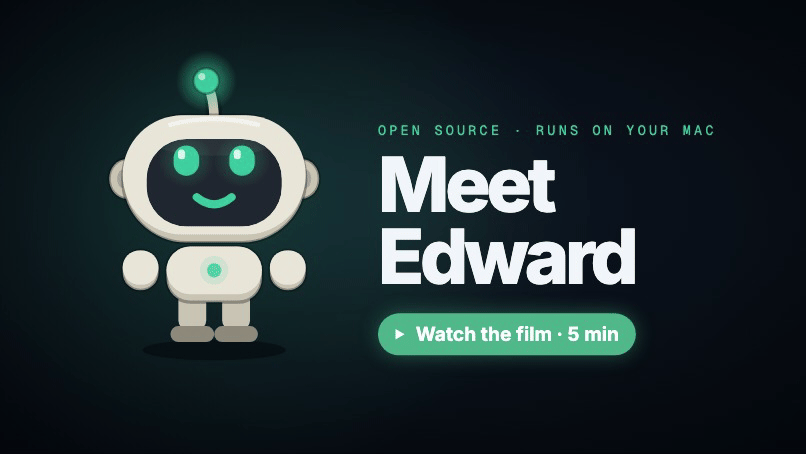
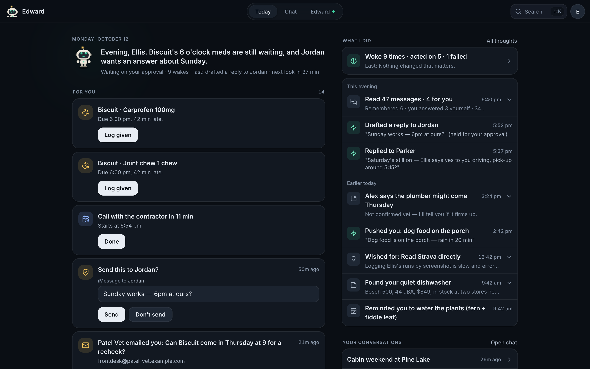
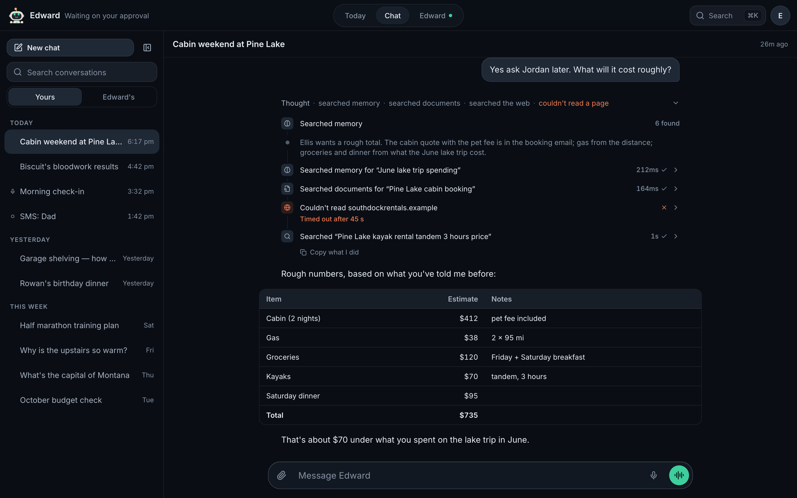
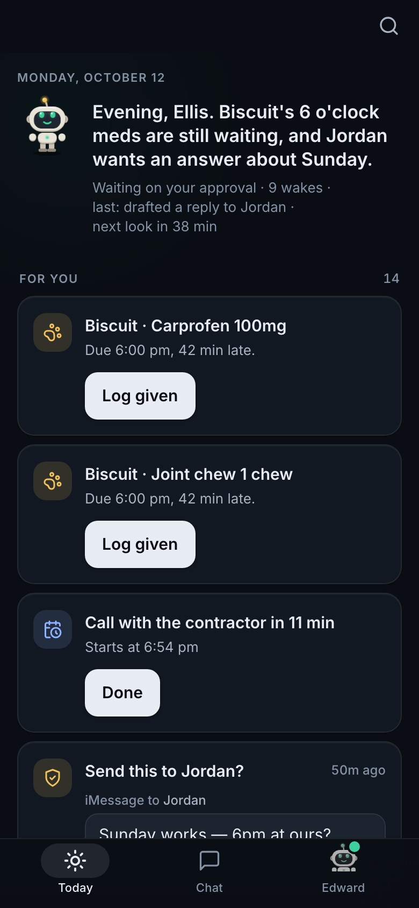
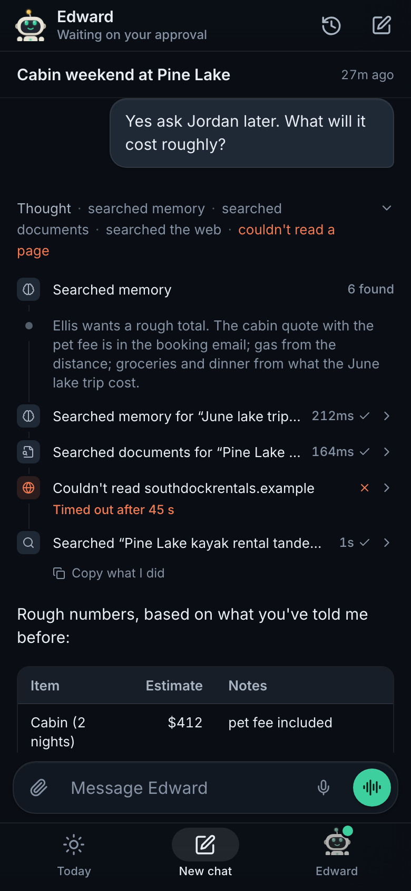
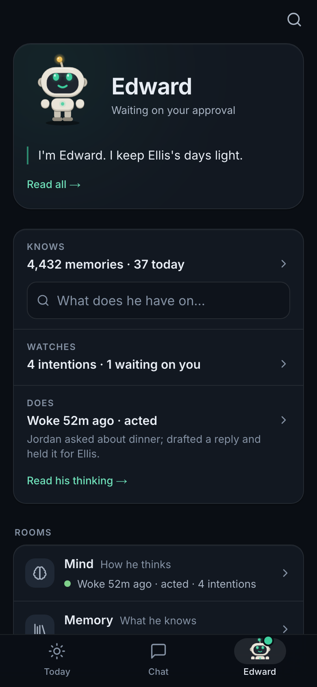
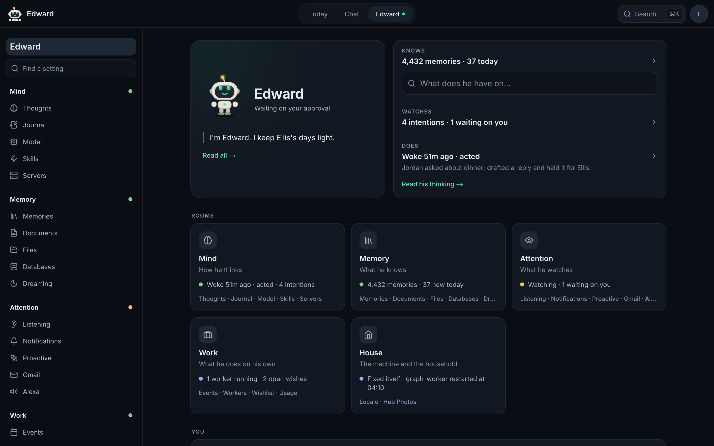
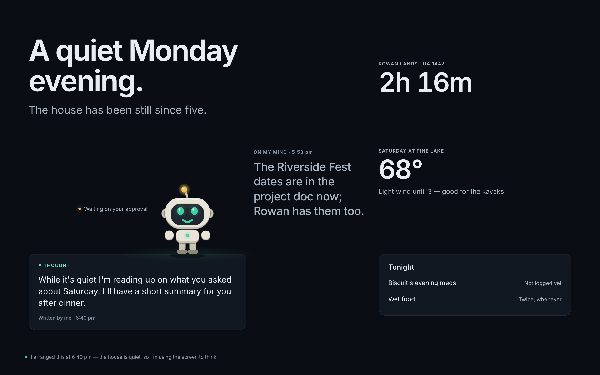
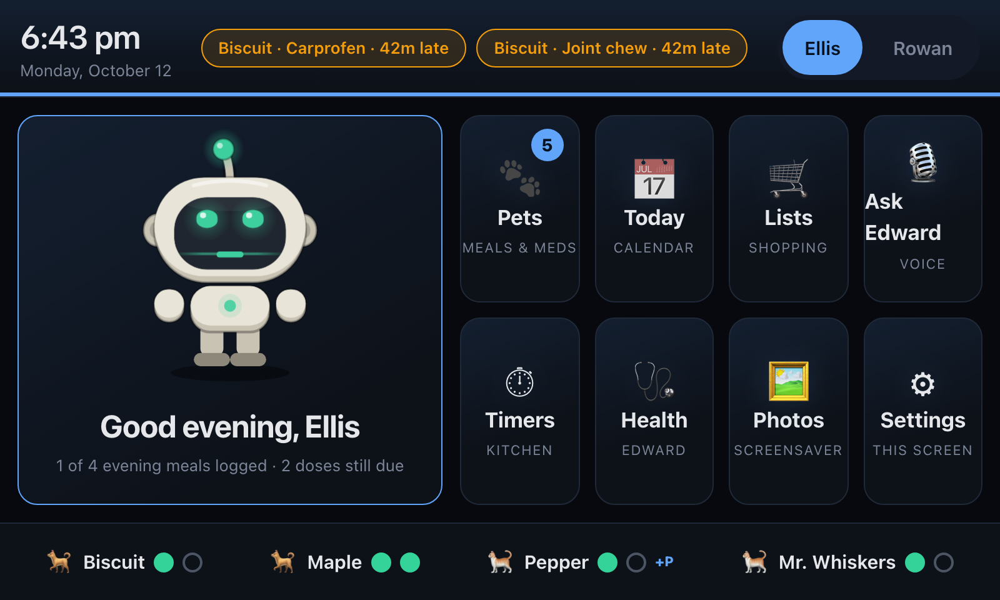

<p align="center">
  
</p>

<h1 align="center">Edward</h1>

<p align="center">
  <strong>An open-source AI assistant that remembers, notices what matters, and works on your Mac — for one person: you.</strong>
</p>

<p align="center">
  <a href="LICENSE"></a>
  <a href="https://github.com/ben4mn/meet-edward/stargazers"></a>
  <a href="CONTRIBUTING.md"></a>
  <a href="https://github.com/ben4mn/meet-edward/commits/main"></a>
  <a href="https://meet-edward.com"></a>
</p>

<p align="center">
  <a href="https://meet-edward.com">Website</a> &nbsp;·&nbsp;
  <a href="https://meet-edward.com/docs">Docs</a> &nbsp;·&nbsp;
  <a href="https://meet-edward.com/blog">Blog</a> &nbsp;·&nbsp;
  <a href="#quick-start">Quick Start</a> &nbsp;·&nbsp;
  <a href="https://meet-edward.com/#film">Watch the Film</a>
</p>

---

## Demo

<p align="center">
  <a href="https://meet-edward.com/#film">
    
  </a>
  <br />
  <sub><b>Meet Edward</b>, a five-minute film. It plays on <a href="https://meet-edward.com/#film">meet-edward.com</a>, or <a href="https://meet-edward.com/video/meet-edward.mp4">download the MP4</a>. The people and pets in it are invented; the screens are the real app on test data.</sub>
</p>

## Screenshots

This release in the UX fixture harness, with invented data: the owner Ellis, their partner Rowan and the dog Biscuit aren't real.

<p align="center">
  <br />
  <sub><b>Today</b>: what needs you, with the action on the card, and what Edward did on his own.</sub>
</p>

<p align="center">
  <br />
  <sub><b>Chat</b>, with the work rail open: his reasoning and every tool call, including the one that failed.</sub>
</p>

<p align="center">
  
  &nbsp;
  
  &nbsp;
  <br />
  <sub>The installed PWA on an iPhone.</sub>
</p>

<details>
<summary><strong>The Edward tab, his screen and the household hub</strong></summary>

<p align="center">
  <br />
  <sub><b>The Edward tab</b>: what he knows, watches and does, and the five rooms his settings live in.</sub>
</p>

<p align="center">
  <br />
  <sub><b>His screen</b> (<code>/screen</code>): a stage he arranges on the host Mac's display.</sub>
</p>

<p align="center">
  <br />
  <sub><b>The household hub</b> (<code>/hub</code>) on a 7-inch touchscreen.</sub>
</p>

</details>

## Why Edward?

Most assistants start every conversation from nothing and wait to be asked. Edward is built the other way round:

- **He remembers, and knows where he heard it.** Every memory records who said it (you, someone in your messages, or Edward himself), what it is about, and how sure he is. Ask him "how do you know that?" and he can show you.
- **He works for one person.** Edward runs on your own Mac and keeps everything he knows in your own Postgres. The one outside service he needs is the Claude API, which sees what each model call sends it.
- **He has his own computer.** A sandboxed shell, a file editor and a headless browser of his own, with rails against accidents: he can't write his own running code, read his own keys, reach your database or launch other apps. The sandbox guards those things, not your whole account (more under Guard rails, below).
- **He follows through.** When he promises to check back, he schedules it and comes back. He keeps a journal of what he did on his own and why, and you can mark each entry right or wrong.
- **He speaks up once, or not at all.** Noticing what matters in your messages is opt-in, and when it is on he says a thing once, through one door, outside your quiet hours.
- **He has limits you set.** A daily spend cap in dollars, a per-turn cap, a secret scan on everything that leaves, and approvals when you want them.

This release is a snapshot of a build that ran every day for one person for months. The parts that were bespoke to that setup are marked `ADAPT:` in the code and collected in [docs/ADAPTING.md](docs/ADAPTING.md).

## Features

**Memory**
- **Long-term memory with provenance**: pgvector embeddings (a small local model) plus keyword search, blended 70/30. Each memory carries its origin (heard, read, thought, did), whom it is about, a tier (observation, belief, knowledge) and a source. Only your own words make a standing instruction, and only you can change or forget what you said; Edward's own wakes cannot.
- **Upkeep**: hourly consolidation, contradiction flags he asks you about one at a time, a weekly decay pass that never deletes and never retires sensitive things (health, family, pets, money), and a forget that previews exactly what it will remove.
- **Documents**: pages he keeps for you (notes, lists, recipes) and his own state document.

**Talking to him**
- **Chat** in a PWA you can install on your phone, with a work rail that shows his reasoning, tool calls and plans live.
- **Live voice and voice memos** through ElevenLabs (speech to text and text to speech), with barge-in.
- **@Edward pings in iMessage** (once you let him read Messages): write `@Edward` in any chat, message yourself, or reply to his message, and he answers in that chat in his own turn. Friends can ping him too, inside limits (a few turns an hour per chat, no new conversations with people who did not ask, unknown numbers held for you, and no shell, file editor, Chrome or screens in their turns unless you set `EDWARD_FRIENDS_FULL_TOOLSET=on`). His messages go out from your own iMessage account on the host Mac, signed as Edward.

**Doing things on his own**
- **Wakes and follow-through**: when he says he will check back, he wakes up and does. A silent nightly reflection at 03:00, and one small budgeted block of free time a day for his own projects (it reaches nobody).
- **A thought journal**: every wake that acts or commits writes why it looked, what it noticed, what it did and why, with a "right call?" verdict for you.
- **Noticing (opt-in)**: with `EDWARD_PROACTIVITY` on, he reads incoming messages and mail for what matters to you and decides to stay silent, leave a note, or push. Off by default.
- **His own computer**: `bash` in a persistent sandboxed shell (macOS Seatbelt) in `~/edward-home`, a file editor, web search and fetch, a headless browser of his own (Playwright's shell, never your Chrome), and `look` for images and PDFs. Fourteen tools in total, the same on every surface.
- **Optional hands in your Chrome**: with the Edward extension loaded and `EDWARD_CHROME_HANDS=on`, he can use your logged-in Chrome. Typing outside a search box or pressing send/post acts as you and runs only when you asked in that turn; payments are refused in every turn. Off by default.
- **Scheduling**: reminders, one-off and recurring (cron) tasks in your time zone, and changes to your Calendar and Reminders when you ask.

**Where he shows up**
- **Today**: the app's front door. What needs you (with the action on the card), today's digest, what he did, your conversations.
- **An iPhone widget** through [Scriptable](https://scriptable.app) (`scriptable/`): he decides what it shows.
- **His screen** (`/screen`): a stage he arranges on the host Mac's display, with what he is thinking while he works.
- **An optional household hub** (`/hub`): a touchscreen page for a kitchen or a pet station — pets' feeding and meds, the family calendar, lists, timers, voice, a photo screensaver. Built so alerts stay rare: only timed doses ever go overdue.
- **Push notifications** (Web Push), with quiet hours (22:00–07:00 by default) and a ledger of everything sent.
- **A menu-bar companion** for the Mac you sit at (`companion/EdwardBar`).

**Integrations**
- Gmail (OAuth), Mail.app, Calendar, Reminders, Contacts — Apple data read from the Mac's own databases.
- iMessage, Twilio SMS and WhatsApp (a number of Edward's own), and the WhatsApp bridge (`whatsapp-mcp`).
- Alexa and Home Assistant (announcements on Echo devices), Brave Search.

**Guard rails**
- **The trust boundary**: a secret scan on everything that leaves (commands, sends, fetched URLs, typing, pushes); turns that read untrusted content are marked, and `EDWARD_TAINT_APPROVALS=on` holds their outward calls for your Approve/Deny.
- **His computer's sandbox** (macOS Seatbelt): his shell can't write the checkout Edward runs from, Postgres' files or the Python and Postgres installs it relies on; can't read Edward's own keys (the session key, the setup code, `.env`); and can't reach Edward's own API, his databases or the WhatsApp bridge. It stops accidents and a command he was talked into, but it is **not a containment boundary**: the shell runs as your macOS user and can write the rest of your home (shell startup files, `~/Library/LaunchAgents`) and Homebrew, from which programs run outside the sandbox. For strong isolation, run Edward as a separate macOS user ([docs/ADAPTING.md](docs/ADAPTING.md#g-edward-under-his-own-macos-user); the full list is in [computer.md](docs/architecture/computer.md#what-the-sandbox-is-and-isnt)).
- **Friends' pings stay off your machine**: a friend's `@Edward` gets no shell, file editor, Chrome or screens, and `look` only at what they sent or a link, because their message is someone else's text driving a turn on your Mac. `EDWARD_FRIENDS_FULL_TOOLSET=on` gives them everything. Their turns can still read what Edward reads (your chats, memories and calendar) and answer with the discretion his prompt asks for, which is a prompt, not a wall.
- **A daily spend cap** (default $5 over your local day): background work stops first, Edward's own turns next, and your own turns may run into a small reserve. Every call is priced and shown in the app.

## Quick Start

**You need:** a Mac with Apple silicon that can stay on, the Xcode command-line tools (`xcode-select --install`), [Homebrew](https://brew.sh), and an [Anthropic API key](https://console.anthropic.com/). A Mac mini makes a good always-on host.

**1. Install.**

```bash
git clone https://github.com/ben4mn/meet-edward.git && cd meet-edward
./setup.sh          # installs everything, asks for your name, API key and time zone
```

**2. Start Edward, one of two ways.** Pick one; you don't need both.

- **Always on** (the usual choice for the Mac that hosts him). launchd starts him now and at every login, and restarts him if he stops:

  ```bash
  bash scripts/install-launchagents.sh
  ```

  `./setup.sh --launchagents` does the same at the end of setup. If you already started Edward by hand from this checkout, the installer stops that copy first.

- **By hand.** He runs until you stop him or the Mac restarts:

  ```bash
  ./restart.sh        # backend :8000, frontend :3000
  ```

The first start takes a few minutes: the backend downloads its small embedding model and sets up the database, and the frontend runs its first build. `./restart.sh` waits for each (up to 2 minutes for the backend, 4 for the frontend); if one is still busy after that, it says "still starting", leaves it running and exits 0. Watch it with `tail -f /tmp/edward-backend.log`.

**3. Choose a password, on the Mac itself.** Open [http://localhost:3000](http://localhost:3000) on the Mac that runs Edward. The first visit asks for a password and a one-time setup code. Read the code in a terminal on that Mac, from your checkout:

```bash
cat backend/.setup_code
```

The backend makes the code when it starts and no password exists yet. Only your macOS user can read the file, and it is deleted once the password is set. The log and the scripts say only where the code is, never what it is. Case and dashes don't matter. After 10 wrong codes in 15 minutes, setup pauses until the oldest ages out; wrong codes never count against signing in.

Until a password is set, the API answers nothing but the sign-in pages. The setup request also has to come from a page at `localhost` on this Mac, so a phone or another computer on your network is told to use the Mac. That check reads request headers, though, and a device on your network can forge them; the code is what keeps someone else from claiming your Edward first. If the Mac has no screen, forward the port from your own computer (`ssh -L 3000:localhost:3000 you@my-mac.local`), open http://localhost:3000 there, and read the code over ssh (`ssh you@my-mac.local cat <your checkout>/backend/.setup_code`).

`./setup.sh` is safe to run again; each step checks what is already there. It stops before installing anything on an Intel Mac or in a Rosetta shell ([Platform support](#platform-support)). It installs `python@3.12`, `postgresql@16` and `node` with Homebrew, builds pgvector from source for Postgres 16, creates the `edward` database, makes `backend/.venv` with pinned dependencies, installs Playwright's headless shell, runs `npm ci`, builds two small Swift helpers (media and EventKit), and writes `.env` from `.env.example`.

| Flag | What it adds |
|---|---|
| `--with-test-db` | the backend tests' own Postgres cluster on :5433 |
| `--launchagents` | runs `scripts/install-launchagents.sh` at the end |
| `--no-helpers` | skips building the Swift helpers |
| `--non-interactive` | never prompts; takes `EDWARD_OWNER_NAME`, `ANTHROPIC_API_KEY` and `TIMEZONE` from the environment |

`scripts/install-launchagents.sh` installs the backend, the frontend, a health check every five minutes (plus a deeper one at 08:00), a nightly backup at 03:30 (to `~/edward-backups` unless `EDWARD_BACKUP_DIR` says otherwise; the dumps are readable by you alone) and a daily memory report, labelled `com.meet-edward.*` (`EDWARD_LAUNCHD_PREFIX`). It takes `--with-graph`, `--without-backup`, `--dry-run` and `--uninstall`. With the agents loaded, `./restart.sh` (or `./restart.sh backend|frontend`) restarts through launchd. It only ever restarts its own checkout's Edward: in a second clone or a worktree it refuses (exit 78) to touch agents that run another checkout. Logs are in `/tmp/edward-backend.log` and `/tmp/edward-frontend.log`.

**After you sign in:**
1. **Settings → Mind → Skills.** Every skill starts off on a fresh install, so Edward can use none of them until you turn them on here. Turn on what Edward may use: Shell/Bash (his computer: `bash` and the editor), Web Search, iMessage, Push Notifications, iOS Widget.
2. **Settings → House → Locale.** Check your time zone: reminders, quiet hours and "today" follow it.
3. **macOS permissions** (System Settings → Privacy & Security), only for what you use:
   - **Full Disk Access** for the python `setup.sh` prints at the end. Edward reads iMessage, Mail, Contacts, Calendar and Reminders from their databases through it. If you start Edward by hand with `./restart.sh` rather than the LaunchAgents, macOS charges your terminal app instead, so grant that too.
   - **Automation**: macOS asks the first time Edward sends a message or drives Chrome.
   - **Calendars and Reminders** (for changes): run `bash backend/scripts/eventkit_request_access.sh` while sitting at the Mac.

   [docs/ADAPTING.md](docs/ADAPTING.md#3-macos-permissions) has the full list, and what to redo after `brew upgrade python@3.12`.

**Reaching him from your phone.** Installing the PWA, push notifications and the microphone all need HTTPS. Put a tunnel (Cloudflare Tunnel, Tailscale, ngrok) or a reverse proxy in front of port 3000, set `EDWARD_PUBLIC_BASE_URL` to that address, and name the tunnel's LaunchAgent in `EDWARD_TUNNEL_LABEL` so the health check watches it. The backend listens on every interface so devices on your network (a hub) can reach it; `EDWARD_BACKEND_HOST=127.0.0.1` keeps it to this Mac. Sign-in allows 5 failed tries per client in 15 minutes, and 100 from all clients together (past that, signing in pauses for everyone until the oldest failures age out; changing your password is limited per signed-in session instead, and never by that ceiling); behind a tunnel the client is read from the tunnel's own headers, so leave uvicorn's `FORWARDED_ALLOW_IPS` unset ([auth-and-pwa.md](docs/architecture/auth-and-pwa.md#backend-auth)).

## Configuration

Everything lives in `.env` at the repo root; [`.env.example`](.env.example) describes every setting with its default. The backend loads it itself (a value set in its environment wins), and the start scripts never export it. Most values are read on every call; restart the backend to be sure (`./restart.sh backend`).

**About you** (`backend/services/owner.py`):

| Variable | What it is |
|---|---|
| `EDWARD_OWNER_NAME` | What Edward calls you. Unset, he says "the owner". |
| `EDWARD_OWNER_FULL_NAME`, `EDWARD_OWNER_ALIASES` | Other names you go by, so he recognises you in messages. |
| `EDWARD_OWNER_HANDLES` | Your phone numbers, emails and Apple ID: how he recognises your iMessages and your self-chat. |
| `EDWARD_OWNER_EMAILS` | Your email addresses: mail from these is yours, and he never emails you. |
| `EDWARD_HOUSEHOLD` | The people at the household hub, you first. |
| `TIMEZONE` | Your IANA zone, until the app's own setting is loaded. |

**This Mac** (`backend/services/host_config.py`): `EDWARD_PUBLIC_BASE_URL` (where you open Edward; links in pushes and texts use it), `EDWARD_TUNNEL_LABEL`, `EDWARD_BACKEND_HOST`, `EDWARD_LAUNCHD_PREFIX`, `EDWARD_BACKUP_DIR`. The frontend bakes its public origin (`NEXT_PUBLIC_BASE_URL`, default `EDWARD_PUBLIC_BASE_URL`, used for link previews) into the build, so after changing it run `bash frontend/deploy-build.sh` and restart the frontend. The session cookie is `Secure`, which assumes HTTPS (browsers generally make an exception for `http://localhost`). If signing in at a plain-HTTP address keeps sending you back to the login page, and it is a network you trust, set `EDWARD_COOKIE_SECURE=off`.

**The model and the money.** `EDWARD_LLM_PROVIDER=anthropic` is the default: every call goes to the Claude API, one route per purpose (Sonnet for chat, wakes and the screens, Haiku for background memory work, Opus for evaluations), each overridable with `EDWARD_CLAUDE_<PURPOSE>_MODEL` and friends. `EDWARD_DAILY_SPEND_CAP_USD` (default 5), `EDWARD_TURN_MAX_USD` (3.00) and `EDWARD_AUTONOMOUS_TURN_MAX_USD` (1.00) bound the spend.

**Off by default, and how to turn it on:**

| What | How |
|---|---|
| Reading your iMessages, and @Edward pings | Settings → Attention → Listening → Messages; Full Disk Access; Messages on this Mac signed into your Apple ID; `EDWARD_OWNER_HANDLES` |
| Mail.app | Listening → Email; Full Disk Access; keep Mail.app running |
| Gmail | an OAuth client (`GMAIL_CLIENT_ID`, `GMAIL_CLIENT_SECRET`; [docs/gmail-setup.md](docs/gmail-setup.md)), then Settings → Attention → Gmail → Watch my inbox |
| Noticing | `EDWARD_PROACTIVITY=shadow` (decides, never speaks), then `notice` |
| Hands in your Chrome | load `chrome-extension/` unpacked in Chrome, then `EDWARD_CHROME_HANDS=on` ([chrome-extension/README.md](chrome-extension/README.md)) |
| His shell, editor, your Chrome and the screens in friends' pings | `EDWARD_FRIENDS_FULL_TOOLSET=on`, at a risk: a friend's message then drives a shell that runs as you ([pings.md](docs/architecture/pings.md#the-reply-turn)) |
| Approvals for tainted turns | `EDWARD_TAINT_APPROVALS=shadow` (log only) or `on` |
| Voice | `ELEVENLABS_API_KEY`, `ELEVENLABS_VOICE_ID` |
| Push | `npx web-push generate-vapid-keys` into `VAPID_PUBLIC_KEY` / `VAPID_PRIVATE_KEY` |
| The hub's pets and care | copy `backend/hub_seed.example.json` to `backend/hub_seed.json`, describe your own, set `EDWARD_HUB_SEED=hub_seed.json` |
| The hub's photo door (a photos-only login) | `PHOTO_DOOR_PASSWORD_HASH` (a bcrypt hash, in single quotes; `.env.example` has the command that makes one) |
| Twilio SMS / WhatsApp | `TWILIO_*` and `EDWARD_OWNER_HANDLES`. Inbound webhooks are refused without `TWILIO_AUTH_TOKEN`, and only texts from your own numbers get an answer: anyone else's are held in the ledger, unanswered. `EDWARD_TWILIO_ANSWER_ANYONE=on` answers everyone, at a risk ([.env.example](.env.example)) |
| WhatsApp bridge | run the `whatsapp-mcp` Go bridge yourself, then `MCP_WHATSAPP_ENABLED=true` |
| apple-mcp (a fallback for Apple apps) | install bun, clone apple-mcp, `MCP_APPLE_ENABLED=true` |
| Alexa / Home Assistant | `ALEXA_SKILL_ID`, `HOME_ASSISTANT_URL`, `HOME_ASSISTANT_TOKEN` ([docs/alexa-setup.md](docs/alexa-setup.md)). Inbound Alexa requests are not signature-checked yet; leave `ALEXA_SKILL_ID` unset unless you use the skill. |
| Brave Search | `BRAVE_SEARCH_API_KEY` (only needed when the Claude server-side web tools are off, or on the Codex fallback) |
| Knowledge graph | `GRAPHITI_ENABLED=true` (queues every new memory) **and** `GRAPHITI_INGEST_ENABLED=true` (the worker drains the queue into the graph), then `bash scripts/install-launchagents.sh --with-graph`. Without the second switch the graph stays empty and the queue only grows. Each memory costs a few background model calls |
| Credits countdown | `EDWARD_CREDITS_START_USD` and `EDWARD_CREDITS_START_DATE` |
| HTML hosting | `HTML_HOSTING_URL` and `HTML_HOSTING_API_KEY` (no default host) |
| The Codex fallback | `EDWARD_LLM_PROVIDER=codex`: GPT through the Codex CLI's ChatGPT login. That is not an official API for third-party apps; use it at your own risk. |

[docs/ADAPTING.md](docs/ADAPTING.md#5-off-by-default) lists every default, including what is on (the spend cap, quiet hours, the two daily wakes, the nightly backup).

The iPhone widget: copy `scriptable/edward-widget.js` into Scriptable and fill in your public address and your widget token (open `/api/widget/token` on your Edward while signed in). Treat the token like your password: besides the widget, it can chat with Edward as you (`POST /api/widget/chat`). Put it only on your own devices, and if it leaks, replace it with `POST /api/widget/token/regenerate` while signed in.

## Architecture

```
Next.js PWA (:3000)  ──/api──▶  FastAPI (:8000)  ──▶  PostgreSQL 16 + pgvector (:5432)
Today · Chat · Voice                  │
Edward tab · /screen · /hub           │
                                      ├─ a turn (LangGraph): preprocess → retrieve_memory → respond (tool loop) → extract_memory
                                      ├─ one toolset of 14 tools; bash runs in a Seatbelt sandbox in ~/edward-home
                                      ├─ listeners: iMessage (chat.db), Mail, Gmail → the mind (wakes, noticing, pings)
                                      ├─ scheduler (every 30 s), consolidation (hourly), the screens' pulse
                                      └─ the Claude API: ChatClaude, one route per purpose, a daily dollar cap
```

The backend runs natively on macOS, not in Docker: it reads Apple's databases, talks to Messages over AppleScript, and sandboxes Edward's shell with Seatbelt. Every subsystem has its own page in [docs/architecture/](docs/architecture/README.md).

## Platform support

**macOS on Apple silicon only.** Intel Macs are not supported: `setup.sh` stops before installing anything on an Intel Mac, in a Rosetta (x86_64) shell, or with an x86_64 Python, because the pinned PyTorch behind the local embedding model has no x86_64 macOS wheel. The EventKit helper (changing Calendar and Reminders) needs macOS 14 or later; on an older macOS `setup.sh` warns and Edward runs without it. Linux and Windows (WSL) are not supported: `setup.sh` stops on anything but macOS, Edward's `bash` tool needs macOS Seatbelt and fails closed without it, and the Apple integrations (iMessage, Mail, Calendar, Reminders, Contacts) have nothing to read. If you want to try a port, [docs/ADAPTING.md](docs/ADAPTING.md) lists the macOS-specific seams.

## Documentation

- [CLAUDE.md](CLAUDE.md) — the operating guide: the rules that must hold, how to run and test, every route and setting. Written for Claude sessions working in this repo (point yours at it), and just as useful for people.
- [docs/architecture/](docs/architecture/README.md) — one page per subsystem, with the reasons and incidents behind each rule.
- [docs/ADAPTING.md](docs/ADAPTING.md) — the parts built for one particular setup, and how to fit them to yours.
- [docs/UPGRADING.md](docs/UPGRADING.md) — moving an install of the March 2026 release onto this one.
- [meet-edward.com/docs](https://meet-edward.com/docs) — guides, including setting Edward up with an AI assistant.

## Upgrading from the March 2026 release

This release replaces the March 2026 public version. Self-evolution, the Lightpanda browser, the Python/JavaScript/SQL sandboxes, LangSmith and the morning briefing are gone; your memories, conversations, documents, files and scheduled events are kept and migrated in place on first start. Back up first, then follow [docs/UPGRADING.md](docs/UPGRADING.md).

## Contributing

Contributions are welcome. [CONTRIBUTING.md](CONTRIBUTING.md) covers setup, the test database, the checks a change must pass and the privacy rules. Open an issue first to talk about what you would like to change.

## License

[Apache 2.0](LICENSE)

## Thanks

To [cchen362](https://github.com/cchen362) for the orchestrator fix (worker tools reported "Error: None" on success, [#5](https://github.com/ben4mn/meet-edward/pull/5)), which this release carries.
